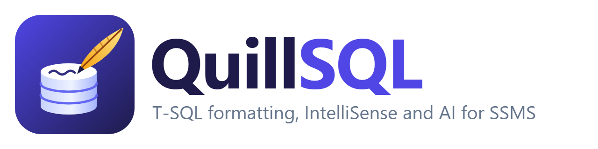

<p align="center">
  <picture>
    <source media="(prefers-color-scheme: dark)" srcset="assets/logo/png/quillsql-logo-dark.png">
    
  </picture>
</p>

<p align="center">
  <b>English</b> · <a href="README.vi.md">Tiếng Việt</a>
</p>

<p align="center">
  <a href="https://github.com/taivt0109/QuillSQL/releases/latest"></a>
  <a href="https://github.com/taivt0109/QuillSQL/actions/workflows/ci.yml"></a>
  <a href="LICENSE"></a>
</p>

**QuillSQL** makes writing T-SQL in SQL Server Management Studio faster and safer. It formats your
code, suggests tables, columns and joins as you type, expands snippets, refactors, flags risky
code, keeps a history of your queries, and can ask Claude to write, explain or tune SQL using your
real schema and execution plans. It is free and open source, with a fast Rust engine that also
runs on the command line and in CI.

## What it does

| | |
|---|---|
| **Format** | One shortcut lays out a script or a selection: lists, joins, `CASE`, `AND`/`OR`, casing, semicolons. Configurable, and it refuses to change anything it cannot verify. |
| **IntelliSense** | Tables, views, columns, procedures, schemas, CTEs and variables as you type, from the connected database. |
| **Writes code for you** | Join conditions from foreign keys, `EXEC` with every parameter, `INSERT ... VALUES` and `UPDATE ... SET` with every column, `*` expanded to columns. |
| **Snippets** | About 70 built in (`ssf` + Tab → `SELECT * FROM`), your own in JSON, and "surround with" for a selection. |
| **Refactoring** | Qualify object names, add or remove `AS`, smart rename, encapsulate as a stored procedure, inline an `EXEC`. Each is one Undo step. |
| **Code analysis** | 54 rules underline problems as you type (`SELECT *`, `= NULL`, `UPDATE` without `WHERE`, deprecated syntax...). Fix them all with one command. |
| **AI with Claude** | Write SQL from a sentence, explain or review a script, and analyze execution plans and Query Store with real indexes and row counts. |
| **Object cards** | Rest the mouse on a table to see its columns, keys, indexes, partitions and script; F12 scripts it. |
| **Safety at a glance** | Color the tab and editor of production connections; ask before `DELETE` or `UPDATE` without `WHERE`; highlight every use of a name. |
| **Database tools** | Find procedures and views that reference objects that no longer exist; search the history of every query you ran. |
| **Your way** | An Options window for every behavior, keyboard shortcuts for every command, English or Vietnamese. |
| **Schema and Data Compare** | Compare two databases' schema or data, see every difference, and deploy a script that makes them match. In SSMS, as its own app, or in CI with SQL Compare's command-line switches. |
| **Command line** | `quill` formats folders of `.sql` files and runs the analysis in CI. |

## Install

Requirements: Windows with SQL Server Management Studio 21 or later. The AI commands also need
the [Claude Code CLI](https://code.claude.com/docs/en/overview), installed and signed in.

Close SSMS, then run in PowerShell:

```powershell
irm https://raw.githubusercontent.com/taivt0109/QuillSQL/main/install.ps1 | iex
```

This installs the extension into every SSMS 21 or later on the machine, and the `quill` command
line tool into `%LOCALAPPDATA%\QuillSQL\bin` (added to your PATH). It needs no admin rights, and
every download is checked against the release's `SHA256SUMS.txt` before it is installed. Start
SSMS: everything is under **Tools > QuillSQL**.

Run the same command again to update, or set an option first:

```powershell
$env:QUILLSQL_VERSION = '0.2.0'    # install a specific version
$env:QUILLSQL_NO_CLI = '1'         # only the SSMS extension
$env:QUILLSQL_UNINSTALL = '1'      # remove QuillSQL
irm https://raw.githubusercontent.com/taivt0109/QuillSQL/main/install.ps1 | iex
```

### Updates

Once a day QuillSQL looks for a newer release on GitHub. When it finds one, it downloads it,
checks its checksum and shows a bar at the top of SSMS: **Install when SSMS closes**, **What's
new** or **Skip this version**. SSMS cannot replace an extension while it runs, so the update is
installed right after SSMS exits. **Tools > QuillSQL > Check for Updates** checks now. To turn the
daily check off, create `%LOCALAPPDATA%\QuillSQL\settings.json` containing
`{ "autoUpdate": false }`, or untick it in Options.

## Shortcuts

| Keys | Command |
|---|---|
| Ctrl+K, Ctrl+Y or Ctrl+Shift+Alt+F | Format the script or selection |
| Ctrl+Space | Open the suggestion list |
| F12 or Ctrl+B, Ctrl+D | Script the table, view, procedure or function at the caret |
| Ctrl+B, Ctrl+K | Object card at the caret (or rest the mouse on a name) |
| Ctrl+B, Ctrl+W | Expand wildcards (or Tab right after `*`) |
| Ctrl+B, Ctrl+Q | Qualify object names |
| Ctrl+B, Ctrl+R | Smart rename |
| Ctrl+B, Ctrl+C | Insert semicolons |
| Ctrl+B, Ctrl+U / Ctrl+B, Ctrl+L | UPPERCASE / lowercase keywords |
| Ctrl+B, Ctrl+E | Execute the statement at the caret |
| Ctrl+B, Ctrl+B | Execute the batch at the caret |
| Ctrl+B, Ctrl+T | Summarize the script (go to any statement) |
| Ctrl+B, Ctrl+S | Insert snippet |
| Ctrl+B, Ctrl+A / Ctrl+B, Ctrl+F | Analyze code / fix code issues |
| Ctrl+B, Ctrl+H | Query history |
| Ctrl+B, Ctrl+I | AI Chat |
| Ctrl+B, Ctrl+G / Ctrl+B, Ctrl+P | Ask AI / analyze the plan with AI |
| Ctrl+B, Ctrl+O | Options |

Change any of them in Tools > Options > Environment > Keyboard (search for `QuillSQL`). Every
command is also in **Tools > QuillSQL** and in the editor's right-click menu.

## Options and language

**Tools > QuillSQL > Options...** (Ctrl+B, Ctrl+O) has a page for each area: general, suggestions,
typing, formatting (with a live preview), code analysis rules, running queries, tab colors, AI,
snippets and shortcuts. The interface is in **English or Vietnamese**: pick the language on the
General page; it follows the Windows language until you do.

## Features in detail

### Formatting

**Tools > QuillSQL > Format T-SQL** (Ctrl+Shift+Alt+F) formats the selection, or the whole script
if nothing is selected. One Undo reverts it.

```sql
-- Before
select c.Name,sum(o.Total) total from dbo.Customers c join sales.Orders o on o.CustomerId=c.CustomerId where o.Total>100 and c.Name like 'A%' group by c.Name

-- After, with "applyCasing": true
SELECT c.Name,
       sum(o.Total) total
FROM dbo.Customers c
JOIN sales.Orders o
    ON o.CustomerId = c.CustomerId
WHERE o.Total > 100
    AND c.Name LIKE 'A%'
GROUP BY c.Name
```

The formatter works on tokens. After formatting it reads its own output back and compares it with
the original; if anything other than whitespace and the rewrites you asked for changed, or the
script has an unterminated string, comment or identifier, it reports an error and leaves your code
alone. Lines between `-- quill-format-off` and `-- quill-format-on` are never touched. See
[Formatting options](#formatting-options) to change the layout.

### IntelliSense

As you type, a list offers:

- tables, views, table functions, schemas and CTEs after `FROM`, `JOIN`, `INTO` and `UPDATE`;
- procedures after `EXEC`, objects after `schema.`;
- columns after `alias.` or `table.`, and the columns of every table in the statement inside
  `SELECT`, `WHERE` and `ON` (a name found in two tables is inserted with its alias);
- columns inside `INSERT INTO t (`, and the variables declared in the script after `@`;
- the columns of temporary tables and table variables the script defines (`CREATE TABLE #t`,
  `DECLARE @t TABLE`, `SELECT ... INTO #t`);
- objects of another database of the server after `OtherDb.` and `OtherDb.dbo.`, with their
  columns; linked servers after `FROM`;
- only the words that can come next: after `c.Name ` the operators and clauses (AND, LIKE, IS,
  ORDER BY...), after `INNER` JOIN, after `IS` NULL, after `ORDER BY c.Name ` ASC and DESC, data types
  after `CAST(x AS` and `DECLARE @x`, table hints in `WITH (`, query hints in `OPTION (`, and the
  statements where one starts;
- in DDL and permissions: what follows `ALTER TABLE t`, the table's columns after `ALTER COLUMN`,
  in `CREATE INDEX ... ON t (` and `INCLUDE (`, column options in `CREATE TABLE`, objects after
  `GRANT ... ON`; `WHEN MATCHED THEN` and its actions in MERGE;
- after `EXEC name a, `, the parameters not given yet.

The first item is selected only when what you typed matches it for sure: the whole word, its start,
or the initials of its parts (`cid` for CustomerId). Otherwise nothing is selected and Enter and
Tab keep their usual meaning. The item picked for some letters is selected first the next time.

Up/Down moves, Enter or Tab inserts, Esc closes, Ctrl+Space opens the list. Next to the list, a
box shows the definition of the selected table, view or procedure. Which keys insert (Tab, Enter,
Space, `.`, `,`, `(`) is up to you in Options. Metadata loads in the
background the first time a database is used and follows `USE`. When tables, columns or other
objects change, by you or anyone else, it reloads by itself: a light check runs at most once a
minute while you type, and at once on Ctrl+Space. **Tools > QuillSQL > Refresh T-SQL Suggestions**
reloads everything.

The list also writes code:

- after `FROM` and `JOIN`, the table with its schema and an alias: `Cust` + Tab gives
  `dbo.Customers AS c` (both can be turned off in Options);
- after `JOIN`, tables related by a foreign key, with an alias and the condition:
  `sales.Orders AS o ON o.CustomerId = c.CustomerId`; after `ON`, the condition alone;
- after `ALTER PROCEDURE`, `ALTER VIEW` or `ALTER FUNCTION`, the object's whole definition;
- built-in and scalar functions with their parentheses, the caret inside: `GETDATE()`;
- after `EXEC`, the procedure with all its parameters, one per line with its type;
- after `INSERT INTO table `, the column list and a `VALUES` row with a placeholder per column;
  after `UPDATE table SET `, every column (identity, computed and rowversion columns are skipped);
- in a select list, **(choose columns…)** opens a list of check boxes to insert several columns at
  once;
- aliases leave out prefixes such as `tbl` (`tblCustomer AS c`), or use your own per table; both are
  set in Options.

While you type the arguments of a function or procedure, a tip above the line shows its
parameters, the current one in bold (Esc closes it).

F12 on a procedure, view or function created `WITH ENCRYPTION` offers to decrypt it. QuillSQL then
reads the definition over the dedicated admin connection (DAC), which needs a sysadmin login and,
when SSMS runs on another computer, "remote admin connections" turned on; nothing is changed on
the server. SQL Server Express and LocalDB start without the DAC.

While you type, `'`, `[` and `/*` are closed for you (and `(` if you turn it on); typing the
closing character moves over it.

QuillSQL turns off SSMS's own "Auto list members" so that two lists do not open; turn it back on
in Tools > Options > Text Editor > Transact-SQL > IntelliSense.

### Snippets

Type a prefix and press Tab, or pick it from the list. **Tools > QuillSQL > Insert Snippet...**
lists them all; with text selected, the snippet wraps it (`tc` for TRY...CATCH, `be` for
BEGIN...END, `timings` to time it).

Add your own as JSON files in `%LOCALAPPDATA%\QuillSQL\Snippets` (one with a built-in prefix
replaces it), then restart SSMS:

```json
{ "prefix": "sel", "description": "Select from a table", "body": "SELECT $CURSOR$ FROM $table$;",
  "placeholders": [{ "name": "table", "defaultValue": "dbo.MyTable" }] }
```

Bodies can use `$CURSOR$`, `$SELECTEDTEXT$`, `$SELECTIONSTART$`/`$SELECTIONEND$`, `$DATE$`,
`$TIME$`, `$USER$`, `$MACHINE$`, `$SERVER$`, `$DBNAME$` and `$PASTE$` (the clipboard). The first
`$name$` placeholder is selected after insertion so you can type over it.

### Refactoring

Under **Tools > QuillSQL**:

- **Expand Wildcards**: `*` and `alias.*` become the column names. Tab right after a `*` does the
  same for that one wildcard.
- **Qualify Object Names**: adds schemas to tables, views and procedures, and aliases to columns
  in queries over more than one table.
- **Add AS to Aliases** / **Remove AS from Aliases**.
- **Smart Rename...**: renames the variable (in its batch), alias or CTE (in its statement) under
  the caret. For a table, view, procedure or column it opens an `sp_rename` script, with a query
  listing the objects that use the old name, for you to review and run.
- **Encapsulate as Stored Procedure...**: turns the selection into a `CREATE PROCEDURE` script;
  variables it uses without declaring become typed parameters.
- **Inline EXEC**: replaces the `EXEC` under the caret with the procedure's body, declaring each
  parameter with its argument or default.

### Code analysis

Problems are underlined a moment after you stop typing; hover to read them. **Analyze Code**
lists them in the Error List, and **Fix Code Issues** applies every safe fix at once: `!=` to
`<>`, `= NULL` to `IS NULL`, `@@IDENTITY` to `SCOPE_IDENTITY()`, `TOP 5` to `TOP (5)`, table hints
without `WITH`, missing schemas, `SELECT *` and `INSERT` without a column list. **Toggle Code
Analysis Underlines** switches the underlines off and on.

Each rule has a stable code whose prefix gives its kind: BP best practice, DEP deprecated, EI
execution issue, MI miscellaneous, PE performance, ST style, SC script. `RULES` in
[`src/analysis.rs`](src/analysis.rs) lists all 54.

### AI with Claude

These commands use the Claude Code CLI on your machine, with all of Claude's tools turned off so
it can only answer.

**AI Chat** (Ctrl+B, Ctrl+I, or the button on the Standard toolbar) is a panel beside the query
windows for a conversation on one topic: ask, then keep asking, and Claude remembers what was said.

- Under the box, choose what to send with the question: the **query** (or the selection),
  **table definitions**, the **estimated plan** or the **actual plan** (with row counts and
  indexes), or the **slow queries** from Query Store. **Show what was sent** under your message
  shows exactly what Claude received.
- Answers stream in as they are written. Each SQL block has **Insert into editor** (at the caret,
  selected, one Undo step), **Open in new window** and **Copy**. Suggested next questions appear
  under the last answer; click one to ask it.
- **New chat** starts another topic; **History** reopens an earlier one to continue it. Chats
  are kept in `%LOCALAPPDATA%\QuillSQL\chats`.
- Enter sends, Shift+Enter starts a new line, Esc stops an answer.
- **Each conversation is about one query window**, shown above the box: "Ask about:
  SQLQuery3.sql server / database". A new chat takes the tab you have open; once you have asked,
  it stays on that window even when you switch tabs, and shows "You are in SQLQuery5.sql · Add
  it · Ask only about it" instead of guessing. **Add tab** puts more windows in the conversation,
  to compare queries, even on different servers; × removes one. Claude reads the queries from
  those windows ("this query" is enough), each plan and lookup runs on the connection of the
  window it is about, and each step names that window.
- **Claude looks things up itself.** While it answers, Claude can read the connected database
  through read-only tools: find objects and columns, describe a table (columns, keys, indexes,
  partitions), read a definition, index usage, missing-index hints, statistics, an estimated plan,
  Query Store, the queries running now and the server settings. Each lookup shows as a step under
  the answer; click it to see what Claude read.
  In depth, it can also find which queries use an index, queries that got slower, what queries
  wait on, plan warnings (implicit conversions, spills, key lookups...), parameter sniffing,
  procedure statistics, memory grants, CPU/IO/memory use, blocking chains, locks, open
  transactions, recent deadlocks, unused and duplicate indexes, foreign keys without an index,
  heaps, stale statistics, page splits and lock waits per index, file latency, log and tempdb use,
  identity columns close to their limit, recent schema changes and connections.
- **Let AI read data** (off by default) also lets Claude run read-only SELECTs, measure a query
  and profile a column, at most 200 rows, in a transaction that is always rolled back; statements
  that write are refused.
- Each lookup may take at most 60 seconds; change it in **Options > AI** (10 to 600).
- Nothing needs installing or configuring in Claude Code: QuillSQL serves these tools from SSMS
  on 127.0.0.1, only during an answer, behind a one-time token, and passes them to `claude` for
  that answer only.

The commands below start a new topic in the chat with the right context, so you can ask follow-up
questions:

- **Explain with AI** and **Review with AI**: the selection or script and its tables.
- **Analyze Plan with AI**: the row counts, sizes, indexes and statistics dates of the tables the
  query uses, and its estimated execution plan (compiled, never run).
- **Analyze Actual Plan with AI (runs the query)...**: the same with measured rows, reads and time
  per operator. It runs the query and discards the results, so it only accepts read-only scripts
  and asks you first.
- **Find Slow Queries with AI (Query Store)**: the 10 most expensive queries of the last 7 days,
  the plans of the slowest, and their tables' indexes.

**Ask AI...** (Ctrl+B, Ctrl+G) writes SQL from a request ("top 10 customers by order total this
year"), or rewrites the selection ("add paging"), straight into the editor, selected, as one Undo
step. Optional settings in
`%LOCALAPPDATA%\QuillSQL\ai.json`: `{ "model": "sonnet", "language": "English" }`, where
`language` is the language of explanations and comments.

### Safety at a glance

- **Colored tabs**: query windows connected to servers you mark get a colored document tab.
  Right-click a server or a database in Object Explorer and choose
  **QuillSQL: Tab Color...** (or use **Tab Color for This Connection...** in the QuillSQL menu),
  pick Production, Staging, UAT, Development, Test or any color, for that database or for every
  database on the server. Options > Tab colors also colors servers by a word in their name, and
  adds the usual environments in one click. Rules are kept in `%USERPROFILE%\.quillsql-colors.json`:

  ```json
  [{ "match": "prod", "color": "#C62828", "label": "PRODUCTION" },
   { "match": "test", "color": "#2E7D32" }]
  ```

  `match` is looked for in "server / database", ignoring case; the most specific (longest)
  match wins, so a database's color beats its server's, which beats a word.
- **Object cards**: rest the mouse on a table, view, procedure or function (or press Ctrl+B,
  Ctrl+K) for a card with its row count, size, columns (keys, identity, defaults, foreign keys),
  indexes and where they are stored, and a **Script** tab with Copy and Open buttons. A
  partitioned table says so at the top: column, partition function, `RANGE LEFT`/`RIGHT`, scheme,
  and a **Partitions** tab with each partition's range, rows and filegroup. **F12** opens the
  script in a new window, including the partition function and scheme. Hold **Ctrl** and names
  of objects are underlined like links: **Ctrl+click** opens the card pinned, so it stays open
  while you read it, type or move around, until you close it with ✕ or Esc. The pin button on a
  hovered card does the same.
- **Run with care**: running a `DELETE` or `UPDATE` without `WHERE` asks first, with Cancel as the
  default answer. `TRUNCATE TABLE` and `DROP` can be added in Options.
- **Highlighting**: every use of the variable, alias or name under the caret is highlighted.

### Database tools

- **Find Invalid Objects** lists procedures, views and functions that reference objects that no
  longer exist, in the Output window.
- **Query History...** (Ctrl+B, Ctrl+H, or the button on the Standard toolbar) searches every query you ran (F5) and every query window
  you closed, with its server and database. Open one in a new window or copy it. The last 5000
  are kept in `%LOCALAPPDATA%\QuillSQL\history.jsonl`.

### Editing commands

Under **Tools > QuillSQL**: insert semicolons, unformat, add or remove square brackets, uppercase
or lowercase keywords, remove comments, convert an `sp_executesql` call back to plain SQL, add
commas (or quotes and commas) to the selected lines, keep a selection unformatted, execute the
statement or batch at the caret, summarize the script, format every open tab, duplicate a tab,
close unmodified tabs, create a snippet from the selection, and turn QuillSQL off and on.

## Privacy

QuillSQL runs on your machine and talks only to:

- **your SQL Server**, with the query window's own connection, to read metadata, plans and Query
  Store;
- **GitHub**, once a day, to look for updates (turn it off with `"autoUpdate": false`);
- **Claude**, through your Claude Code CLI, only when you run an AI command. It sends your
  request, the selection or script, and the names and types of the tables it uses; the plan
  commands add row counts, index definitions and a plan summary (which includes literal and
  parameter values from the query); Query Store review adds the slowest queries' text. In the AI
  chat, Claude can also look up metadata, statistics, plans, Query Store and the running queries
  through the read-only tools. Table rows are sent only if you turn on **Let AI read data**, and
  then only the rows of the SELECTs Claude runs (at most 200 each).

Query history stays in `%LOCALAPPDATA%\QuillSQL\history.jsonl` (the last 5000 entries). It holds
the full text of your scripts, so delete it if they contain secrets.

## Command line

```powershell
quill -p .\scripts                # format every .sql file, recursively
quill -p .\scripts --check        # report only; exit code 1 if anything would change
quill -p a.sql -b                 # keep the original as a.sql.bak
Get-Content a.sql | quill --stdin # stdin to stdout
quill --analyze -p .\scripts      # code analysis as file:line:column: severity CODE message
```

Exit codes: 0 success, 1 changes found (`--check`) or warnings (`--analyze`), 2 error. UTF-8 and
UTF-16 files keep their encoding; files in a legacy code page are refused rather than guessed at.
Run `quill --help` for every option.

## Schema and Data Compare

Compare two databases and make the second like the first: their **schema** (tables, columns,
keys, indexes, views, procedures, functions, types, sequences, synonyms, users, roles,
permissions, extended properties) or their **data** (row by row, by primary key or a key you
choose).

- **In SSMS:** right-click a database in Object Explorer > **QuillSQL: Compare Schema With...**
  or **Compare Data With...** (the database is the source, with its connection), or
  **Tools > QuillSQL > Schema Compare / Data Compare**.
- **Without SSMS:** **QuillSQL Compare** in the Start menu (`QuillCompare.exe`).
- **In CI:** `quill schema` and `quill data`, below.

The window has the same four tabs as SQL Compare: **Data sources**, **Table mapping** (Data
Compare: **Tables & views**, with keys, WHERE filters and columns to leave out), **Owner mapping**
and **Options** (every SQL Compare / Data Compare option, with QuillSQL defaults, My defaults and
Save as my defaults). Results show what differs; for schema, the SQL of both sides line by line.
**Deploy** shows the script and its warnings (data loss, truncation, NOT NULL...) and runs it in
one transaction, or opens it in a query window. QuillSQL Compare follows the Windows light or dark
mode and accent color (Mica on Windows 11); in SSMS it uses the SSMS color theme.

Projects are saved as `.qsc` (schema) and `.qdc` (data) JSON files that you can keep in Git.
Passwords are never written to them: "Remember credentials" keeps them in Windows Credential
Manager. SQL Compare `.scp` and SQL Data Compare `.sdc` projects open too (without passwords).

### Command line

The switches, aliases and exit codes are the ones `SQLCompare.exe` and `SQLDataCompare.exe` use,
so a pipeline can swap the executable:

```powershell
$env:QUILL_PASSWORD1 = '...'; $env:QUILL_PASSWORD2 = '...'
quill schema /s1:dev /db1:Shop /u1:deploy /s2:prod /db2:Shop /u2:deploy /verbose
quill schema /s1:dev /db1:Shop /s2:prod /db2:Shop /scriptfile:deploy.sql /synchronize /abortOnWarnings:High
quill schema /project:DEV_to_PROD.qsc /assertidentical            # exit 0 identical, 79 different
quill schema /s1:prod /db1:Shop /makesnapshot:prod.json          # compare later with /snapshot2:prod.json
quill data /s1:dev /db1:Shop /s2:test /db2:Shop /include:Table:^\[dbo\] /export:C:\out /synchronize
```

| | |
|---|---|
| Sources | `/server1..2` (`/s1`), `/database1..2` (`/db1`), `/username1..2` + `/password1..2` or `QUILL_PASSWORD1..2` (omit for Windows authentication), `/activedirectory1..2` (Microsoft Entra: with `/username` + `/password` a password sign-in, else the account signed in to the Azure CLI; `QUILL_ACCESS_TOKEN1..2` takes a ready token), `/connection1..2` (connection string), `/encrypt1..2` (off by default, as in SQL Compare; an unencrypted connection does not validate the server certificate), `/trustServerCertificate1..2`, `/snapshot1..2`, `/backup1..2`, `/scripts1..2`, `/sca1..2`, `/sourcecontrol1..2` with `/revision1..2` and `/scriptsfolderxml1..2`, `/empty2`, `/project` (.scp, .sdc, .qsc, .qdc; passwords saved in .scp/.sdc are used) |
| Choose | `/include` and `/exclude` with `type[:regex]` (object types, `Identical`, `Different`, `Missing`, `Additional`), `/options:Default,IgnoreComments,...`; data: `/comparisonkeys`, `/includeColumns`, `/excludeColumns` |
| Output | `/scriptfile`, `/synchronize`, `/report` + `/reporttype:Xml\|Html\|Classic\|Excel` (SQL Compare's XML layout; Excel as SpreadsheetML, or .xlsx when the file name ends so), `/reportAllObjectsWithDifferences` (`/rad`), `/outputProject` (.scp, .sdc or .qsc), `/export` (data, CSV), `/json`, `/showWarnings`, `/abortOnWarnings:Medium\|High`, `/transactionIsolationLevel`, `/force`, `/out`, `/outputwidth`, `/logLevel`, `/argfile`, `/quiet`, `/verbose` |
| Exit codes | 0 success · 3 switch given twice · 8 switch needs or excludes another · 11 flag given a value · 32/33/34 value out of range / overflow / invalid · 61 stopped by warnings · 63 identical · 64 usage · 65 corrupt input · 69 not supported · 73 report or project failed · 74 file exists (use `/force`) · 77 access denied · 79 `/assertidentical` and different · 126 database error · 130 Ctrl+C · 500 unexpected error |

## Formatting options

`quill --style file.json` and the extension (which reads `%USERPROFILE%\.quillsql.json`) take a
small options file. Every field is optional:

```json
{
  "layout": true,
  "indentSize": 4,
  "leadingCommas": false,
  "applyCasing": true,
  "prefixUnicode": false,
  "insertSemicolons": true,
  "encloseIdentifiers": "WithoutBrackets",
  "tableAliasStyle": "AddAs"
}
```

`encloseIdentifiers` also accepts `WithBrackets`, and `tableAliasStyle` `RemoveAs`. For finer
control, a sectioned style groups settings by `whitespace`, `lists`, `joinStatements`,
`caseExpressions` and more, and only needs the values that differ from the defaults in
[`src/quill_defaults.json`](src/quill_defaults.json). The CLI warns about any setting it ignores.

## Files and settings

| Path | What it is |
|---|---|
| `%USERPROFILE%\.quillsql.json` | Formatting options |
| `%USERPROFILE%\.quillsql-colors.json` | Tab and bar colors per server |
| `%LOCALAPPDATA%\QuillSQL\settings.json` | Everything set in the Options window |
| `%LOCALAPPDATA%\QuillSQL\ai.json` | AI model and answer language |
| `%LOCALAPPDATA%\QuillSQL\Snippets\` | Your snippets |
| `%LOCALAPPDATA%\QuillSQL\history.jsonl` | Query history |
| `%LOCALAPPDATA%\QuillSQL\quillsql.log` | Log; an empty file named `verbose` next to it logs more |

## Build from source

Requires Rust (stable) and Visual Studio 2022 with MSBuild; the VS SDK comes from NuGet.

```powershell
cargo test
.\vsix\build.ps1                 # builds quill.exe and vsix\QuillSql.Vsix\bin\Release\QuillSql.Vsix.vsix
.\vsix\install.ps1               # close SSMS first; -RootSuffix Exp for a test instance, -Uninstall to remove
```

```
src/      Rust engine: lexer, formatter, IntelliSense, refactoring, analysis, plans, snippets
tests/    Engine tests
vsix/     SSMS extension: a thin C# shell that runs quill.exe as a separate process
assets/   Logo (SVG sources; assets\logo\render.ps1 makes the PNGs and the .ico)
scripts/  set-version.ps1
```

SSMS loads only in-process .NET Framework packages, so the extension is C#; it holds no SQL logic
and talks to the engine over a pipe, so an engine crash cannot take SSMS down.

To release: `.\scripts\set-version.ps1 0.3.0`, commit, then push the tag `v0.3.0`. The Release
workflow tests, builds and publishes `QuillSQL.vsix`, `quill.exe` and `SHA256SUMS.txt`, and
installed copies offer the update within a day.

## Known limits

- QuillSQL reads T-SQL as tokens rather than a full parse. It covers everyday queries, DML and
  DDL; unusual syntax may get no suggestion, rewrite or warning, but it is not changed wrongly.
- With Microsoft Entra logins, QuillSQL connects with the sign-in SSMS keeps for the query
  window, asking SSMS for a fresh access token each time it connects, so an expired token is
  renewed the same way SSMS renews it. If SSMS cannot renew it silently, run a query in the window
  to sign in again. When SSMS keeps no token for the window (Microsoft Entra MFA, Integrated,
  Default, Password, Managed Identity, Service Principal), QuillSQL connects the way SSMS does, with
  the same method and account, reusing the sign-in SSMS already made; if that asks to sign in and
  you cancel, it tries again only on Refresh T-SQL Suggestions. Device code sign-in is not used.
  This relies on SSMS internals and is new: report it if a window is not read.
- Compare's Microsoft Entra sign-in: "integrated" takes the token of the account signed in to the
  Azure CLI (`az login`) rather than Windows' own single sign-on, and "MFA" uses the device-code
  page (microsoft.com/devicelogin). Federated (ADFS) password sign-in is not supported. Entra
  sign-in has not been checked against a live Azure SQL server.
- A database linked to SQL Source Control is compared through its scripts folder (git, Subversion
  or Mercurial) with `/sourcecontrolN`; `/databaseN` with `/revisionN` needs SQL Source Control and
  exits 69.
- `insertSemicolons` skips ambiguous places, for example before `THROW`.
- Smart Rename of database objects produces a script; it does not change other objects for you.
- Compare writes certificates and keys as comments only (their private keys can't be read), as SQL
  Compare does. Full-text and PolyBase objects, and files written by Redgate SQL Backup (`.sqb`),
  are covered by unit tests but have not been checked against a live server or real SQL Backup
  files.
- Compare treats string literals in modules, defaults and checks as case-sensitive even when the
  comparison is not: `'abc'` and `'ABC'` store or return different data. SQL Compare reports them
  equal. Windows users across domains, FileTables and Stretch tables are covered by unit tests
  only.
- The Compare windows are in English only for now.
- Tab colors depend on the layout of SSMS 21's document tabs and may need an update for a future
  SSMS.

## License

[MIT](LICENSE)
