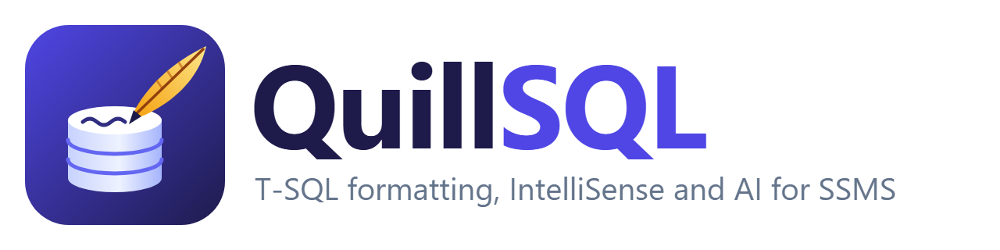

<p align="center">
  <picture>
    <source media="(prefers-color-scheme: dark)" srcset="assets/logo/png/quillsql-logo-dark.png">
    
  </picture>
</p>

<p align="center">
  <a href="README.md">English</a> · <b>Tiếng Việt</b>
</p>

<p align="center">
  <a href="https://github.com/taivt0109/QuillSQL/releases/latest"></a>
  <a href="https://github.com/taivt0109/QuillSQL/actions/workflows/ci.yml"></a>
  <a href="LICENSE"></a>
</p>

**QuillSQL** giúp viết T-SQL trong SQL Server Management Studio nhanh hơn và an toàn hơn. Nó:
- format code;
- gợi ý bảng, cột và điều kiện JOIN ngay khi gõ;
- mở rộng snippet, refactor, cảnh báo code có rủi ro;
- lưu lịch sử query;
- nhờ Claude viết, giải thích hoặc tối ưu SQL dựa trên schema và execution plan thật của bạn.

QuillSQL miễn phí, mã nguồn mở. Engine viết bằng Rust, chạy nhanh, và dùng được cả trên dòng lệnh lẫn trong CI.

## QuillSQL làm được gì

| | |
|---|---|
| **Format** | Một phím tắt sắp xếp lại cả script hoặc đoạn đang chọn: danh sách cột, JOIN, `CASE`, `AND`/`OR`, chữ hoa/thường, dấu chấm phẩy. Tùy chỉnh được. Phần nào không kiểm chứng được là đúng thì không thay đổi. |
| **IntelliSense** | Gợi ý bảng, view, cột, procedure, schema, CTE và biến ngay khi gõ, lấy từ database đang kết nối. |
| **Viết code giúp bạn** | Sinh điều kiện JOIN từ khóa ngoại, `EXEC` kèm đủ tham số, `INSERT ... VALUES` và `UPDATE ... SET` kèm đủ cột, mở `*` thành danh sách cột. |
| **Snippet** | Khoảng 70 snippet có sẵn (`ssf` + Tab → `SELECT * FROM`), thêm snippet riêng bằng JSON, bọc đoạn đang chọn bằng snippet. |
| **Refactor** | Thêm schema/alias cho tên, thêm hoặc bỏ `AS`, đổi tên thông minh, gói thành stored procedure, inline một lệnh `EXEC`. Mỗi thao tác hoàn tác được bằng một lần Undo. |
| **Phân tích code** | 54 rule gạch chân lỗi ngay khi gõ (`SELECT *`, `= NULL`, `UPDATE` không có `WHERE`, cú pháp lỗi thời…). Sửa tất cả bằng một lệnh. |
| **AI với Claude** | Viết SQL từ một câu mô tả, giải thích hoặc review script, phân tích execution plan và Query Store dựa trên index và số dòng thật. |
| **Thẻ object** | Rê chuột lên bảng để xem cột, khóa, index, partition và script; F12 để script bảng đó. |
| **Nhận biết nhanh** | Tô màu tab và editor của kết nối production; hỏi lại trước khi chạy `DELETE` hoặc `UPDATE` không có `WHERE`; tô sáng mọi chỗ dùng cùng một tên. |
| **Công cụ database** | Tìm procedure và view đang tham chiếu tới object không còn tồn tại; tìm lại mọi query bạn đã chạy. |
| **So sánh schema và dữ liệu** | So sánh schema hoặc dữ liệu của hai database, xem từng khác biệt, rồi chạy script làm chúng giống nhau. Có trong SSMS, dạng app riêng, và trong CI với switch giống SQL Compare. |
| **Theo ý bạn** | Cửa sổ Options cho mọi hành vi, phím tắt cho mọi lệnh, giao diện tiếng Anh hoặc tiếng Việt. |
| **Dòng lệnh** | `quill` format cả thư mục file `.sql` và chạy phân tích code trong CI. |

## Cài đặt

Yêu cầu:
- Windows có SQL Server Management Studio 21 trở lên.
- Các lệnh AI cần thêm [Claude Code CLI](https://code.claude.com/docs/en/overview), đã cài và đăng nhập.

Đóng SSMS, rồi chạy trong PowerShell:

```powershell
irm https://raw.githubusercontent.com/taivt0109/QuillSQL/main/install.ps1 | iex
```

Lệnh này:
- cài extension vào mọi SSMS 21 trở lên trên máy;
- cài công cụ dòng lệnh `quill` vào `%LOCALAPPDATA%\QuillSQL\bin` và thêm thư mục đó vào PATH;
- không cần quyền admin;
- kiểm tra mọi file tải về với `SHA256SUMS.txt` của bản phát hành trước khi cài.

Mở SSMS lên: mọi thứ nằm trong menu **Tools > QuillSQL**.

Chạy lại đúng lệnh trên để cập nhật. Muốn chọn tùy chọn thì đặt biến môi trường trước:

```powershell
$env:QUILLSQL_VERSION = '0.2.0'    # cài một phiên bản cụ thể
$env:QUILLSQL_NO_CLI = '1'         # chỉ cài extension cho SSMS
$env:QUILLSQL_UNINSTALL = '1'      # gỡ QuillSQL
irm https://raw.githubusercontent.com/taivt0109/QuillSQL/main/install.ps1 | iex
```

### Cập nhật

Mỗi ngày một lần, QuillSQL kiểm tra GitHub xem có bản mới không. Nếu có, nó tải về, kiểm tra checksum, rồi hiện một thanh thông báo ở đầu SSMS với ba lựa chọn:
- **Install when SSMS closes**: cài khi đóng SSMS;
- **What's new**: xem có gì mới;
- **Skip this version**: bỏ qua phiên bản này.

SSMS không cho thay extension khi đang chạy, nên bản cập nhật được cài ngay sau khi SSMS đóng.
- Kiểm tra ngay: **Tools > QuillSQL > Check for Updates**.
- Tắt kiểm tra hằng ngày: tạo file `%LOCALAPPDATA%\QuillSQL\settings.json` với nội dung `{ "autoUpdate": false }`, hoặc bỏ chọn trong Options.

## Phím tắt

| Phím | Lệnh |
|---|---|
| Ctrl+K, Ctrl+Y hoặc Ctrl+Shift+Alt+F | Format script hoặc đoạn chọn |
| Ctrl+Space | Mở danh sách gợi ý |
| F12 hoặc Ctrl+B, Ctrl+D | Script bảng, view, procedure hoặc function tại con trỏ |
| Ctrl+B, Ctrl+K | Thẻ object tại con trỏ (hoặc rê chuột lên tên) |
| Ctrl+B, Ctrl+W | Mở `*` thành danh sách cột (hoặc Tab ngay sau `*`) |
| Ctrl+B, Ctrl+Q | Thêm schema/alias cho tên |
| Ctrl+B, Ctrl+R | Đổi tên thông minh |
| Ctrl+B, Ctrl+C | Chèn dấu chấm phẩy |
| Ctrl+B, Ctrl+U / Ctrl+B, Ctrl+L | Viết HOA / viết thường từ khóa |
| Ctrl+B, Ctrl+E | Chạy câu lệnh tại con trỏ |
| Ctrl+B, Ctrl+B | Chạy batch tại con trỏ |
| Ctrl+B, Ctrl+T | Tóm tắt script (nhảy tới câu lệnh bất kỳ) |
| Ctrl+B, Ctrl+S | Chèn snippet |
| Ctrl+B, Ctrl+A / Ctrl+B, Ctrl+F | Phân tích code / sửa lỗi code |
| Ctrl+B, Ctrl+H | Lịch sử query |
| Ctrl+B, Ctrl+I | Khung chat AI |
| Ctrl+B, Ctrl+G / Ctrl+B, Ctrl+P | Hỏi AI / phân tích plan bằng AI |
| Ctrl+B, Ctrl+O | Tùy chọn |

Đổi phím trong Tools > Options > Environment > Keyboard (tìm `QuillSQL`). Mọi lệnh đều có trong
**Tools > QuillSQL** và trong menu chuột phải của editor.

## Tùy chọn và ngôn ngữ

**Tools > QuillSQL > Options...** (Ctrl+B, Ctrl+O) có một trang cho từng phần: chung, gợi ý, gõ
phím, format (xem trước ngay), rule phân tích code, chạy query, màu tab, AI, snippet và phím tắt.
Giao diện có **tiếng Anh và tiếng Việt**: chọn ngôn ngữ ở trang Chung; khi chưa chọn thì theo
ngôn ngữ của Windows.

## Chi tiết tính năng

### Format

**Tools > QuillSQL > Format T-SQL** (Ctrl+Shift+Alt+F) format đoạn đang chọn, hoặc cả script nếu không chọn gì. Một lần Undo là trả lại như cũ.

```sql
-- Trước
select c.Name,sum(o.Total) total from dbo.Customers c join sales.Orders o on o.CustomerId=c.CustomerId where o.Total>100 and c.Name like 'A%' group by c.Name

-- Sau, với "applyCasing": true
SELECT c.Name,
       sum(o.Total) total
FROM dbo.Customers c
JOIN sales.Orders o
    ON o.CustomerId = c.CustomerId
WHERE o.Total > 100
    AND c.Name LIKE 'A%'
GROUP BY c.Name
```

Bộ format làm việc trên token. Sau khi format, nó đọc lại kết quả và so với bản gốc. Nó báo lỗi và giữ nguyên code của bạn nếu:
- có gì đó thay đổi ngoài khoảng trắng và những phần bạn yêu cầu viết lại; hoặc
- script có chuỗi, comment hay tên trong ngoặc chưa đóng.

Các dòng nằm giữa `-- quill-format-off` và `-- quill-format-on` không bao giờ bị đụng tới. Xem [Tùy chọn format](#tùy-chọn-format) để đổi cách trình bày.

### IntelliSense

Khi gõ, danh sách gợi ý hiện ra:

- bảng, view, hàm trả về bảng, schema và CTE sau `FROM`, `JOIN`, `INTO` và `UPDATE`;
- procedure sau `EXEC`; object sau `schema.`;
- cột sau `alias.` hoặc `table.`;
- cột của mọi bảng trong câu lệnh, khi gõ trong `SELECT`, `WHERE` và `ON`. Tên cột có ở hai bảng sẽ được chèn kèm alias;
- cột trong `INSERT INTO t (`; biến đã khai báo trong script sau `@`;
- cột của bảng tạm và biến bảng mà script tạo ra (`CREATE TABLE #t`, `DECLARE @t TABLE`, `SELECT ... INTO #t`);
- object của database khác trên cùng server sau `OtherDb.` và `OtherDb.dbo.`, kèm cột; linked server sau `FROM`;
- chỉ những từ có thể đứng tiếp theo: sau `c.Name ` là toán tử và mệnh đề (AND, LIKE, IS, ORDER BY...), sau `INNER` là JOIN, sau `IS` là NULL, sau `ORDER BY c.Name ` là ASC và DESC, kiểu dữ liệu sau `CAST(x AS` và `DECLARE @x`, table hint trong `WITH (`, query hint trong `OPTION (`, và các câu lệnh ở đầu một câu lệnh;
- trong DDL và phân quyền: những gì theo sau `ALTER TABLE t`, cột của bảng sau `ALTER COLUMN`, trong `CREATE INDEX ... ON t (` và `INCLUDE (`, tùy chọn cột trong `CREATE TABLE`, object sau `GRANT ... ON`; `WHEN MATCHED THEN` và các hành động trong MERGE;
- sau `EXEC name a, `: các tham số chưa truyền.

Mục đầu tiên chỉ được chọn sẵn khi chữ bạn gõ khớp chắc chắn: trọn từ, phần đầu, hoặc chữ cái đầu của từng phần (`cid` cho CustomerId). Nếu không thì không mục nào được chọn và Enter, Tab giữ nghĩa thông thường. Mục bạn đã chọn cho mấy chữ đó sẽ được chọn sẵn ở lần sau.

Từ khóa gõ bằng chữ thường được tự viết hoa khi gõ dấu cách, xuống dòng hoặc `(`, `)`, `,`, `;` sau nó (`select` thành `SELECT`); tên hàm có sẵn cũng vậy khi theo sau là `(` (`DATEADD(`), và kiểu dữ liệu ở chỗ cần kiểu dữ liệu (`DECLARE @x INT`, `CAST(x AS VARCHAR(10))`, cột trong `CREATE TABLE`), nên cột tên `count` hay `date` vẫn giữ nguyên. Chữ trong chuỗi, comment, ngoặc vuông và sau dấu chấm giữ nguyên. Tắt trong Options > Typing.

Phím tắt: Up/Down để di chuyển, Enter hoặc Tab để chèn, Esc để đóng, Ctrl+Space để mở danh sách. Bên cạnh danh sách có ô hiện card của bảng, view, procedure hoặc function đang chọn, giống như khi rê chuột lên tên: số dòng, dung lượng, cột, index, partition và script. Phím nào dùng để chèn (Tab, Enter, Space, `.`, `,`, `(`) do bạn chọn trong Options.

Metadata được nạp ngầm ở lần đầu dùng một database và tự đổi theo `USE`. Khi bảng, cột hay object khác thay đổi (do bạn hay người khác), metadata tự nạp lại: một lần kiểm tra rất nhẹ chạy tối đa mỗi phút một lần khi bạn đang gõ, và ngay lập tức khi bấm Ctrl+Space. **Tools > QuillSQL > Refresh T-SQL Suggestions** nạp lại toàn bộ.

Danh sách còn viết code giúp bạn:

- **Sau `FROM` và `JOIN`:** bảng kèm schema và alias: gõ `Cust` + Tab ra `dbo.Customers AS c` (tắt được trong Options).
- **Sau `JOIN`:** gợi ý các bảng có khóa ngoại liên quan, kèm alias và điều kiện, ví dụ `sales.Orders AS o ON o.CustomerId = c.CustomerId`. Sau `ON` thì chỉ gợi ý điều kiện.
- **Sau `ALTER PROCEDURE`, `ALTER VIEW`, `ALTER FUNCTION`:** điền sẵn toàn bộ định nghĩa của object.
- **Hàm:** hàm có sẵn và hàm scalar được chèn kèm ngoặc, con trỏ nằm giữa: `GETDATE()`.
- **Sau `EXEC`:** procedure kèm đủ tham số, mỗi tham số một dòng có ghi kiểu dữ liệu.
- **Sau `INSERT INTO table `:** danh sách cột và một dòng `VALUES` có sẵn chỗ điền cho từng cột.
- **Sau `UPDATE table SET `:** tất cả các cột. Cột identity, computed và rowversion được bỏ qua.
- **Trong danh sách SELECT:** mục **(choose columns…)** mở danh sách checkbox để chèn nhiều cột một lúc.
- **Alias:** bỏ qua tiền tố như `tbl` (`tblCustomer AS c`), hoặc dùng alias riêng cho từng bảng; cả hai chỉnh trong Options.

Khi gõ đối số của hàm hoặc procedure, một tooltip phía trên dòng hiện các tham số, tham số hiện tại in đậm (Esc để đóng).

F12 trên procedure, view hoặc function tạo bằng `WITH ENCRYPTION` sẽ hỏi có giải mã không. QuillSQL đọc định nghĩa qua kết nối quản trị riêng (DAC): cần login sysadmin, và nếu SSMS chạy trên máy khác thì server phải bật "remote admin connections". Không có gì bị thay đổi trên server. SQL Server Express và LocalDB mặc định không bật DAC.

Khi gõ, `'`, `[` và `/*` được tự đóng (cả `(` nếu bạn bật); gõ ký tự đóng thì con trỏ chỉ nhảy qua nó.

QuillSQL tắt "Auto list members" của SSMS để không hiện hai danh sách cùng lúc. Muốn bật lại thì vào Tools > Options > Text Editor > Transact-SQL > IntelliSense.

### Snippet

Gõ prefix rồi nhấn Tab, hoặc chọn từ danh sách gợi ý. **Tools > QuillSQL > Insert Snippet...** liệt kê tất cả snippet. Khi đang chọn một đoạn code, snippet sẽ bọc quanh đoạn đó, ví dụ:
- `tc`: TRY...CATCH;
- `be`: BEGIN...END;
- `timings`: đo thời gian chạy.

Snippet riêng là các file JSON đặt trong `%LOCALAPPDATA%\QuillSQL\Snippets`. Snippet trùng prefix với snippet có sẵn sẽ thay thế snippet đó. Thêm xong thì khởi động lại SSMS.

```json
{ "prefix": "sel", "description": "Select from a table", "body": "SELECT $CURSOR$ FROM $table$;",
  "placeholders": [{ "name": "table", "defaultValue": "dbo.MyTable" }] }
```

Phần thân snippet dùng được các biến sau:

| Biến | Ý nghĩa |
|---|---|
| `$CURSOR$` | vị trí con trỏ sau khi chèn |
| `$SELECTEDTEXT$` | đoạn đang chọn |
| `$SELECTIONSTART$`, `$SELECTIONEND$` | vùng sẽ được chọn sau khi chèn |
| `$DATE$`, `$TIME$` | ngày, giờ hiện tại |
| `$USER$`, `$MACHINE$` | tên người dùng, tên máy |
| `$SERVER$`, `$DBNAME$` | server, database đang kết nối |
| `$PASTE$` | nội dung clipboard |

Placeholder `$tên$` đầu tiên được chọn sẵn sau khi chèn để bạn gõ đè lên.

### Refactor

Trong **Tools > QuillSQL**:

- **Expand Wildcards:** đổi `*` và `alias.*` thành danh sách cột. Nhấn Tab ngay sau một dấu `*` cũng làm việc này cho riêng dấu `*` đó.
- **Qualify Object Names:** thêm schema cho bảng, view và procedure; thêm alias cho cột trong các query dùng nhiều bảng.
- **Add AS to Aliases** / **Remove AS from Aliases.**
- **Smart Rename...:** đổi tên biến (trong batch của nó), alias hoặc CTE (trong câu lệnh của nó) tại vị trí con trỏ. Với bảng, view, procedure hoặc cột, lệnh này mở một script `sp_rename` để bạn xem lại rồi tự chạy. Script kèm một query liệt kê các object đang dùng tên cũ.
- **Encapsulate as Stored Procedure...:** biến đoạn đang chọn thành script `CREATE PROCEDURE`. Các biến được dùng mà chưa khai báo trở thành tham số có kiểu.
- **Inline EXEC:** thay lệnh `EXEC` tại con trỏ bằng thân procedure. Mỗi tham số được khai báo với giá trị truyền vào, hoặc giá trị mặc định nếu không truyền.

### Phân tích code

Lỗi được gạch chân sau khi bạn ngừng gõ một chút; rê chuột lên để đọc.
- **Analyze Code:** liệt kê lỗi trong Error List.
- **Fix Code Issues:** áp dụng một lượt mọi cách sửa an toàn:
  - `!=` thành `<>`;
  - `= NULL` thành `IS NULL`;
  - `@@IDENTITY` thành `SCOPE_IDENTITY()`;
  - `TOP 5` thành `TOP (5)`;
  - thêm `WITH` cho table hint;
  - thêm schema còn thiếu;
  - mở `SELECT *` và thêm danh sách cột cho `INSERT`.
- **Toggle Code Analysis Underlines:** bật/tắt gạch chân.

Mỗi rule có một mã cố định; tiền tố cho biết loại rule:

| Tiền tố | Loại |
|---|---|
| BP | best practice |
| DEP | cú pháp lỗi thời |
| EI | lỗi khi thực thi |
| MI | khác |
| PE | hiệu năng |
| ST | phong cách |
| SC | script |

`RULES` trong [`src/analysis.rs`](src/analysis.rs) liệt kê đủ 54 rule.

### AI với Claude

Các lệnh này dùng Claude Code CLI trên máy bạn. Mọi tool của Claude đều bị tắt, nên Claude chỉ có thể trả lời, không làm gì khác trên máy.

**AI Chat** (Ctrl+B, Ctrl+I, hoặc nút trên toolbar Standard) là khung nằm cạnh cửa sổ query để trò chuyện theo từng chủ đề: hỏi rồi hỏi tiếp, Claude nhớ những gì đã nói.

- Dưới ô nhập, chọn thứ cần gửi kèm câu hỏi: **query** (hoặc đoạn đang chọn), **cấu trúc bảng**, **plan ước tính** hoặc **plan thực tế** (kèm số dòng và index), hoặc **query chậm** từ Query Store. Bấm **Xem dữ liệu đã gửi** dưới tin nhắn của bạn để thấy chính xác Claude nhận được gì.
- Câu trả lời hiện dần trong lúc Claude viết. Mỗi khối SQL có nút **Chèn vào editor** (tại con trỏ, bôi đen sẵn, một lần Undo là bỏ), **Mở cửa sổ mới** và **Copy**. Dưới câu trả lời cuối có các câu hỏi gợi ý; bấm vào là hỏi.
- **Chat mới** mở chủ đề khác; **Lịch sử** mở lại cuộc trò chuyện cũ để hỏi tiếp. Lịch sử chat lưu trong `%LOCALAPPDATA%\QuillSQL\chats`.
- Enter để gửi, Shift+Enter xuống dòng, Esc để dừng câu trả lời.
- **Mỗi cuộc chat gắn với một cửa sổ query**, hiện ngay trên ô nhập: "Hỏi về: SQLQuery3.sql server / database". Chat mới lấy tab bạn đang mở; khi đã hỏi rồi thì chat giữ nguyên cửa sổ đó dù bạn chuyển tab, và hiện "Bạn đang ở SQLQuery5.sql · Thêm vào · Chỉ hỏi tab này" thay vì tự đoán. **Thêm tab** đưa thêm cửa sổ vào cuộc chat để so sánh các query, kể cả trên server khác nhau; dấu × để bỏ một cửa sổ. Claude đọc query từ các cửa sổ đó (chỉ cần nói "query này"), mỗi plan và tra cứu chạy trên kết nối của đúng cửa sổ nó nói tới, và mỗi bước ghi rõ cửa sổ.
- **Claude tự tra cứu.** Trong lúc trả lời, Claude đọc được database đang kết nối qua các tool chỉ đọc: tìm đối tượng và cột, xem cấu trúc bảng (cột, khóa, index, partition), đọc định nghĩa, mức dùng index, gợi ý index còn thiếu, statistics, plan ước tính, Query Store, các query đang chạy và cấu hình server. Mỗi lần tra cứu hiện thành một bước dưới câu trả lời; bấm vào để xem Claude đã đọc được gì.
  Tra cứu chuyên sâu: query nào dùng một index, query bị chậm đi, query chờ gì, cảnh báo trong plan (implicit conversion, spill, key lookup...), parameter sniffing, thống kê procedure, memory grant, mức dùng CPU/IO/memory, chuỗi blocking, lock, transaction đang mở, deadlock gần đây, index không dùng và index trùng, khóa ngoại thiếu index, heap, statistics cũ, page split và chờ lock theo index, độ trễ file, transaction log và tempdb, cột identity sắp chạm giới hạn, thay đổi schema gần đây và các kết nối.
- **Cho AI đọc dữ liệu** (mặc định tắt) cho phép Claude chạy câu SELECT chỉ đọc, đo một query và phân tích dữ liệu một cột, tối đa 200 dòng, trong transaction luôn được rollback; câu lệnh có ghi dữ liệu bị từ chối.
- Mỗi lần tra cứu được chạy tối đa 60 giây; chỉnh trong **Options > AI** (10 đến 600).
- Không cần cài hay cấu hình gì trong Claude Code: QuillSQL chạy các tool này ngay trong SSMS trên 127.0.0.1, chỉ trong lúc trả lời, có token dùng một lần, và chỉ truyền cho `claude` của lần trả lời đó.

Các lệnh dưới đây mở chủ đề mới trong khung chat, gửi kèm sẵn dữ liệu phù hợp, để bạn hỏi tiếp:

- **Explain with AI** và **Review with AI:** đoạn đang chọn hoặc cả script, cùng các bảng nó dùng.
- **Analyze Plan with AI:** số dòng, dung lượng, index và ngày cập nhật statistics của các bảng mà query dùng, cùng estimated execution plan (chỉ biên dịch, không chạy query).
- **Analyze Actual Plan with AI (runs the query)...:** như trên nhưng dùng số liệu đo thật (số dòng, số lần đọc, thời gian của từng bước). Lệnh này chạy query rồi bỏ kết quả, nên chỉ nhận script chỉ đọc và hỏi bạn trước khi chạy.
- **Find Slow Queries with AI (Query Store):** 10 query tốn nhất trong 7 ngày qua, plan của các query chậm nhất và index của các bảng liên quan.

**Ask AI...** (Ctrl+B, Ctrl+G) viết SQL từ một yêu cầu ("10 khách hàng có tổng đơn hàng cao nhất năm nay"), hoặc viết lại đoạn đang chọn ("thêm phân trang"), chèn thẳng vào editor và bôi đen sẵn; một lần Undo là bỏ.

Cài đặt tùy chọn nằm trong `%LOCALAPPDATA%\QuillSQL\ai.json`, ví dụ `{ "model": "sonnet", "language": "Vietnamese" }`. `language` là ngôn ngữ của phần giải thích và comment.

### Nhận biết nhanh

- **Tô màu tab:** cửa sổ query kết nối tới server bạn đánh dấu sẽ có tab được tô màu. Chuột phải vào server hoặc database trong Object Explorer, chọn **QuillSQL: Màu tab...** (hoặc **Màu tab cho kết nối này...** trong menu QuillSQL), chọn Production, Staging, UAT, Development, Test hoặc màu bất kỳ, áp cho riêng database đó hoặc mọi database trên server. Options > Tab colors còn tô màu theo một từ trong tên server, và có nút thêm sẵn các môi trường thường dùng. Các quy tắc lưu trong `%USERPROFILE%\.quillsql-colors.json`:

  ```json
  [{ "match": "prod", "color": "#C62828", "label": "PRODUCTION" },
   { "match": "test", "color": "#2E7D32" }]
  ```

  `match` được tìm trong chuỗi "server / database", không phân biệt hoa thường; quy tắc khớp cụ thể nhất (dài nhất) được dùng, nên màu của một database thắng màu của server, và màu server thắng màu theo từ.
- **Thẻ object:** rê chuột lên bảng, view, procedure hoặc function (hoặc nhấn Ctrl+B, Ctrl+K) để xem thẻ gồm số dòng, dung lượng, các cột (khóa, identity, default, khóa ngoại), index và nơi lưu, cùng tab **Script** có nút Sao chép và Mở. Bảng có partition được ghi rõ ở đầu thẻ: cột partition, partition function, `RANGE LEFT`/`RIGHT`, scheme, và tab **Partition** liệt kê khoảng giá trị, số dòng và filegroup của từng partition. **F12** mở script trong cửa sổ mới, gồm cả partition function và scheme. Giữ **Ctrl** thì tên object được gạch chân như link: **Ctrl+click** mở thẻ ở chế độ ghim, thẻ giữ nguyên trong lúc bạn đọc, gõ hay di chuyển, đến khi bấm ✕ hoặc Esc. Nút ghim trên thẻ khi rê chuột cũng làm như vậy.
- **Chạy an toàn:** chạy `DELETE` hoặc `UPDATE` không có `WHERE` sẽ được hỏi lại trước, mặc định là Hủy. Có thể bật thêm cho `TRUNCATE TABLE` và `DROP` trong Options.
- **Tô sáng:** mọi chỗ dùng biến, alias hoặc tên tại con trỏ được tô sáng.

### Công cụ database

- **Find Invalid Objects:** liệt kê procedure, view và function đang tham chiếu tới object không còn tồn tại. Kết quả hiện trong cửa sổ Output.
- **Query History...** (Ctrl+B, Ctrl+H, hoặc nút trên toolbar Standard): tìm trong mọi query bạn đã chạy (F5) và mọi cửa sổ query đã đóng, kèm server và database. Có thể mở lại trong cửa sổ mới hoặc sao chép. 5000 mục gần nhất được lưu trong `%LOCALAPPDATA%\QuillSQL\history.jsonl`.

### Lệnh chỉnh sửa

Trong **Tools > QuillSQL**: chèn dấu chấm phẩy, bỏ format, thêm hoặc bỏ ngoặc vuông, viết hoa hoặc viết thường từ khóa, xóa comment, chuyển lệnh `sp_executesql` về SQL thường, thêm dấu phẩy (hoặc nháy và dấu phẩy) cho các dòng đang chọn, giữ nguyên một đoạn khi format, chạy câu lệnh hoặc batch tại con trỏ, tóm tắt script, format mọi tab đang mở, nhân đôi tab, đóng các tab chưa sửa, tạo snippet từ đoạn chọn, và bật/tắt QuillSQL.

## Quyền riêng tư

QuillSQL chạy trên máy bạn và chỉ kết nối tới:

- **SQL Server của bạn:** dùng chính kết nối của cửa sổ query, để đọc metadata, plan và Query Store.
- **GitHub:** mỗi ngày một lần, để kiểm tra cập nhật. Tắt bằng `"autoUpdate": false`.
- **Claude:** qua Claude Code CLI của bạn, và chỉ khi bạn chạy một lệnh AI. Dữ liệu gửi đi gồm:
  - yêu cầu của bạn, đoạn đang chọn hoặc cả script, và tên/kiểu của các bảng mà script dùng;
  - với lệnh phân tích plan: thêm số dòng, định nghĩa index và bản tóm tắt plan (có chứa các giá trị literal và tham số trong query);
  - với lệnh Query Store: thêm nội dung các query chậm nhất;
  - trong khung chat AI: những gì Claude tự tra cứu qua các tool chỉ đọc (metadata, statistics, plan, Query Store, các query đang chạy).

  Dữ liệu dòng của bảng chỉ được gửi đi khi bạn bật **Cho AI đọc dữ liệu**, và chỉ gồm các dòng của câu SELECT mà Claude chạy (tối đa 200 dòng mỗi câu).

Lịch sử query được lưu ở `%LOCALAPPDATA%\QuillSQL\history.jsonl` (5000 mục gần nhất). File này chứa toàn văn script của bạn; nếu script có thông tin bí mật thì hãy xóa file.

## Dòng lệnh

```powershell
quill -p .\scripts                # format mọi file .sql, kể cả thư mục con
quill -p .\scripts --check        # chỉ báo cáo; mã thoát 1 nếu có file sẽ bị thay đổi
quill -p a.sql -b                 # giữ bản gốc thành a.sql.bak
Get-Content a.sql | quill --stdin # đọc từ stdin, ghi ra stdout
quill --analyze -p .\scripts      # phân tích code, dạng file:dòng:cột: mức-độ MÃ thông-báo
```

Mã thoát:
- `0`: thành công;
- `1`: có thay đổi (`--check`) hoặc có cảnh báo (`--analyze`);
- `2`: lỗi.

File UTF-8 và UTF-16 giữ nguyên encoding. File dùng bảng mã cũ (code page) bị từ chối, vì đoán sai bảng mã có thể làm hỏng file. Chạy `quill --help` để xem mọi tùy chọn.

## So sánh schema và dữ liệu

So sánh hai database rồi làm database thứ hai giống database thứ nhất, theo **schema** (bảng,
cột, khóa, index, view, procedure, function, type, sequence, synonym, user, role, quyền,
extended property) hoặc theo **dữ liệu** (từng dòng, theo khóa chính hoặc khóa bạn chọn).

- **Trong SSMS:** chuột phải database trong Object Explorer > **QuillSQL: So sánh schema với...**
  hoặc **So sánh dữ liệu với...** (database đó là nguồn, dùng sẵn kết nối của nó), hoặc
  **Tools > QuillSQL > So sánh schema / So sánh dữ liệu**.
- **Không cần SSMS:** **QuillSQL Compare** trong Start menu (`QuillCompare.exe`).
- **Trong CI:** `quill schema` và `quill data`, xem bên dưới.

Cửa sổ có đủ 4 tab như SQL Compare: **Data sources**, **Table mapping** (Data Compare là
**Tables & views**, có khóa, bộ lọc WHERE và cột bỏ qua), **Owner mapping** và **Options** (đủ mọi
option của SQL Compare / Data Compare, có QuillSQL defaults, My defaults và Save as my defaults).
Kết quả cho thấy những gì khác nhau; với schema, SQL của hai bên đặt cạnh nhau theo từng dòng.
**Deploy** cho xem script và cảnh báo (mất dữ liệu, cắt chuỗi, NOT NULL...) rồi chạy trong một
transaction, hoặc mở script trong cửa sổ query. QuillSQL Compare theo chế độ sáng/tối và màu nhấn của
Windows (nền Mica trên Windows 11); trong SSMS thì theo theme màu của SSMS.

Project lưu thành file JSON `.qsc` (schema) và `.qdc` (dữ liệu), để trong Git được. Password
không bao giờ được ghi vào file: "Remember credentials" lưu trong Windows Credential Manager.
Mở được cả project `.scp` của SQL Compare và `.sdc` của SQL Data Compare (không kèm password).

### Dòng lệnh

Switch, alias và mã thoát giống `SQLCompare.exe` và `SQLDataCompare.exe`, nên pipeline chỉ cần
đổi tên file chạy:

```powershell
$env:QUILL_PASSWORD1 = '...'; $env:QUILL_PASSWORD2 = '...'
quill schema /s1:dev /db1:Shop /u1:deploy /s2:prod /db2:Shop /u2:deploy /verbose
quill schema /s1:dev /db1:Shop /s2:prod /db2:Shop /scriptfile:deploy.sql /synchronize /abortOnWarnings:High
quill schema /project:DEV_to_PROD.qsc /assertidentical            # mã 0 nếu giống, 79 nếu khác
quill schema /s1:prod /db1:Shop /makesnapshot:prod.json          # so sau bằng /snapshot2:prod.json
quill data /s1:dev /db1:Shop /s2:test /db2:Shop /include:Table:^\[dbo\] /export:C:\out /synchronize
```

| | |
|---|---|
| Nguồn | `/server1..2` (`/s1`), `/database1..2` (`/db1`), `/username1..2` + `/password1..2` hoặc `QUILL_PASSWORD1..2` (bỏ trống là Windows authentication), `/activedirectory1..2` với `QUILL_ACCESS_TOKEN1..2`, `/connection1..2` (connection string), `/encrypt1..2` (mặc định tắt, như SQL Compare; kết nối không mã hóa thì không kiểm tra chứng chỉ của server), `/trustServerCertificate1..2`, `/snapshot1..2`, `/project` |
| Chọn | `/include` và `/exclude` dạng `type[:regex]` (loại object, `Identical`, `Different`, `Missing`, `Additional`), `/options:Default,IgnoreComments,...`; dữ liệu: `/comparisonkeys`, `/includeColumns`, `/excludeColumns` |
| Kết quả | `/scriptfile`, `/synchronize`, `/report` + `/reporttype:Html\|Xml`, `/export` (dữ liệu, CSV), `/json`, `/showWarnings`, `/abortOnWarnings:Medium\|High`, `/transactionIsolationLevel`, `/force` |
| Mã thoát | 0 thành công · 61 dừng vì cảnh báo · 63 giống nhau · 64 sai cú pháp · 74 file đã có (dùng `/force`) · 79 `/assertidentical` mà khác · 126 lỗi database |

## Tùy chọn format

`quill --style file.json` và extension (đọc file `%USERPROFILE%\.quillsql.json`) nhận một file tùy chọn nhỏ. Trường nào cũng có thể bỏ qua:

```json
{
  "layout": true,
  "indentSize": 4,
  "leadingCommas": false,
  "applyCasing": true,
  "prefixUnicode": false,
  "insertSemicolons": true,
  "encloseIdentifiers": "WithoutBrackets",
  "tableAliasStyle": "AddAs"
}
```

`encloseIdentifiers` nhận thêm giá trị `WithBrackets`; `tableAliasStyle` nhận thêm `RemoveAs`.

Muốn tùy chỉnh chi tiết hơn thì dùng **style theo nhóm**: các thiết lập được chia theo `whitespace`, `lists`, `joinStatements`, `caseExpressions`… Bạn chỉ cần ghi những giá trị khác với mặc định trong [`src/quill_defaults.json`](src/quill_defaults.json). CLI sẽ cảnh báo thiết lập nào không được áp dụng.

## File và cài đặt

| Đường dẫn | Công dụng |
|---|---|
| `%USERPROFILE%\.quillsql.json` | Tùy chọn format |
| `%USERPROFILE%\.quillsql-colors.json` | Màu tab theo server |
| `%LOCALAPPDATA%\QuillSQL\settings.json` | Mọi thiết lập trong cửa sổ Options |
| `%LOCALAPPDATA%\QuillSQL\ai.json` | Model AI và ngôn ngữ trả lời |
| `%LOCALAPPDATA%\QuillSQL\Snippets\` | Snippet của bạn |
| `%LOCALAPPDATA%\QuillSQL\history.jsonl` | Lịch sử query |
| `%LOCALAPPDATA%\QuillSQL\quillsql.log` | Log; tạo thêm file rỗng tên `verbose` cạnh nó để ghi chi tiết hơn |

## Build từ mã nguồn

Cần Rust (bản stable) và Visual Studio 2022 có MSBuild; VS SDK được tải qua NuGet.

```powershell
cargo test
.\vsix\build.ps1                 # build quill.exe và vsix\QuillSql.Vsix\bin\Release\QuillSql.Vsix.vsix
.\vsix\install.ps1               # đóng SSMS trước; -RootSuffix Exp để cài vào instance thử, -Uninstall để gỡ
```

```
src/      Engine Rust: lexer, format, IntelliSense, refactor, phân tích code, plan, snippet
tests/    Test của engine
vsix/     Extension cho SSMS: lớp vỏ C# mỏng, chạy quill.exe thành tiến trình riêng
assets/   Logo (file SVG gốc; assets\logo\render.ps1 tạo PNG và .ico)
scripts/  set-version.ps1
```

SSMS chỉ nạp package .NET Framework chạy chung tiến trình, nên extension phải viết bằng C#. Extension không chứa logic SQL nào; nó nói chuyện với engine qua pipe, nên engine có lỗi cũng không làm SSMS sập.

Phát hành bản mới:
1. Chạy `.\scripts\set-version.ps1 0.3.0`.
2. Commit.
3. Push tag `v0.3.0`.

Workflow Release sẽ chạy test, build và đăng `QuillSQL.vsix`, `quill.exe` cùng `SHA256SUMS.txt`. Các máy đã cài sẽ được đề nghị cập nhật trong vòng một ngày.

## Giới hạn hiện tại

- QuillSQL đọc T-SQL theo token chứ không phân tích cú pháp đầy đủ. Nó xử lý được các query, DML và DDL thường gặp. Với cú pháp lạ, có thể không có gợi ý, không refactor hay không cảnh báo, nhưng code không bị sửa sai.
- Với đăng nhập Microsoft Entra, QuillSQL kết nối bằng phiên đăng nhập mà SSMS đang giữ cho cửa sổ query, và xin SSMS một access token mới mỗi lần kết nối, nên token hết hạn được làm mới giống như SSMS tự làm mới. Nếu SSMS không làm mới được mà không cần hỏi lại, hãy chạy một query trong cửa sổ đó để đăng nhập lại. Khi SSMS không giữ token cho cửa sổ (Microsoft Entra MFA, Integrated, Default, Password, Managed Identity, Service Principal), QuillSQL kết nối giống SSMS, cùng phương thức và tài khoản, dùng lại phiên đăng nhập SSMS đã có; nếu bị hỏi đăng nhập và bạn huỷ, nó chỉ thử lại khi chạy Refresh T-SQL Suggestions. Đăng nhập bằng device code không được dùng. Cách này dựa vào phần nội bộ của SSMS và còn mới: báo lại nếu có cửa sổ không đọc được.
- `insertSemicolons` bỏ qua những chỗ không chắc chắn, ví dụ trước `THROW`.
- Smart Rename với object trong database chỉ tạo script; nó không tự sửa các object khác.
- Compare chỉ ghi certificate và key dưới dạng comment (không đọc được private key), giống SQL Compare. Object full-text, PolyBase và file của SQL Backup (`.sqb`) mới được kiểm tra bằng unit test, chưa chạy trên server thật hay file SQL Backup thật.
- Cửa sổ Compare hiện chỉ có tiếng Anh.
- Tô màu tab phụ thuộc vào cấu trúc tab tài liệu của SSMS 21; một phiên bản SSMS sau này có thể cần cập nhật lại.

## Giấy phép

[MIT](LICENSE)
